# TravelMemory — MERN Stack EC2 Deployment with Multi-AZ Load Balancing & Cloudflare

[](https://aws.amazon.com/)
[](https://nginx.org/)
[](https://nodejs.org/)
[](https://react.dev/)
[](https://www.mongodb.com/atlas)
[](https://www.cloudflare.com/)

Production-grade deployment of the full-stack MERN application **TravelMemory** on Amazon Web Services (AWS). This architecture features horizontal scaling with custom AMIs, two Application Load Balancers across multiple Availability Zones, automated systemd service management (no PM2), Nginx reverse proxying, and custom domain mapping with Cloudflare SSL.

---

## 🔗 Live Deployments & Repository Links

- **Live Application:** [https://bucketvilla.online](https://www.bucketvilla.online)
- **Backend Health Check:** [https://api.bucketvilla.online/hello](https://api.bucketvilla.online/hello)
- **GitHub Repository:** [https://github.com/Mohit456pro/Mohit456pro-TravelMemory-Deployment](https://github.com/Mohit456pro/Mohit456pro-TravelMemory-Deployment)
- **Architecture Diagram File:** [`travelmemory_architecture3.drawio`](./travelmemory_architecture3.drawio.png)

---

## 🏛️ System Architecture

The architecture implements a decoupled, highly available, and resilient two-tier cloud design across multiple AWS Availability Zones (`us-east-1a` and `us-east-1b`):

```
                                    ┌───────────────────────┐
                                    │    User / Browser     │
                                    └───────────┬───────────┘
                                                │
                                                ▼  (HTTPS / Port 443)
                                    ┌───────────────────────┐
                                    │     Cloudflare Edge   │
                                    │  (bucketvilla.online) │
                                    └───────────┬───────────┘
                                                │
                 ┌──────────────────────────────┴──────────────────────────────┐
                 │ CNAME: bucketvilla.online                                   │ CNAME: api.bucketvilla.online
                 ▼ (HTTP / Port 80)                                            ▼ (HTTP / Port 80)
┌──────────────────────────────────────────────┐              ┌──────────────────────────────────────────────┐
│        Frontend Load Balancer (ALB)          │              │         Backend Load Balancer (ALB)          │
│          travelmemory-frontend-alb           │              │           travelmemory-backend-alb           │
└──────────────────────┬───────────────────────┘              └──────────────────────┬───────────────────────┘
                       │                                                             │
                       │ Target Group: travelmemory-frontend-tg                      │ Target Group: travelmemory-backend-tg
        ┌──────────────┴──────────────┐                               ┌──────────────┴──────────────┐
        ▼                             ▼                               ▼                             ▼
┌──────────────────┐          ┌──────────────────┐    API     ┌──────────────────┐          ┌──────────────────┐
│ Frontend Master  │          │    Frontend 2    │  Calls     │  Backend Master  │          │    Backend 2     │
│   (Ubuntu EC2)   │          │   (Ubuntu EC2)   │ ─────────> │   (Ubuntu EC2)   │          │   (Ubuntu EC2)   │
│   us-east-1a     │          │    us-east-1b    │            │   us-east-1a     │          │    us-east-1b    │
│  Nginx Webserver │          │  Nginx Webserver │            │  systemd + Nginx │          │  systemd + Nginx │
└──────────────────┘          └──────────────────┘            └────────┬─────────┘          └────────┬─────────┘
                                                                       │                             │
                                                                       └──────────────┬──────────────┘
                                                                                      │ Mongoose TLS (Port 27017)
                                                                                      ▼
                                                                       ┌─────────────────────────────┐
                                                                       │    MongoDB Atlas Cluster    │
                                                                       │     (Database: travel)      │
                                                                       └─────────────────────────────┘
```

---

## 🚀 Key Highlights & Architectural Decisions

1. **Dual Application Load Balancers:**
   - **Frontend ALB:** Distributes static UI traffic to Nginx servers across Availability Zones.
   - **Backend ALB:** Distributes API requests to Express/Node.js servers across Availability Zones.
2. **systemd Daemon (Zero PM2 Requirement):**
   - Node.js runs as a native Linux service managed by `systemd`.
   - Guarantees automated self-healing upon process crashes and automated startup when secondary instances boot from AMIs.
3. **Nginx Reverse Proxy & React SPA Routing:**
   - Reverse proxies backend traffic from standard port `80` to internal port `3000`.
   - Implements `try_files $uri /index.html;` on frontend instances to support React Router client-side page routing (preventing 404 errors on refresh).
4. **AMI-Driven Horizontal Scaling:**
   - Both frontend and backend baseline master instances were packaged into AMIs (`travelmemory-backend-ami` and `travelmemory-frontend-ami`).
   - Cloned instances were launched into a secondary Availability Zone (`us-east-1b`) for fault tolerance.
5. **Cloudflare Integration & SSL Termination:**
   - Custom domain (`bucketvilla.online`) managed on Cloudflare with Flexible SSL encryption.
   - CNAME flattening routes root and subdomains to dynamic ALB endpoints without requiring static Elastic IPs.

---

## 🛠️ Step-by-Step Deployment Guide

### Phase 1: Database Setup (MongoDB Atlas)
1. Created an M0 cluster on MongoDB Atlas.
2. Configured database user credentials with read/write permissions.
3. Set **Network Access** IP whitelist to `0.0.0.0/0` (Allow Access from Anywhere) to permit dynamic EC2 and ALB public IP addresses.
4. Acquired the database connection string:
   ```env
   MONGO_URI=mongodb+srv://<username>:<password>@cluster0.xxxxx.mongodb.net/travelmemory?retryWrites=true&w=majority
   PORT=3000
   ```

---

### Phase 2: Backend Master Instance Setup
1. Launched an **Ubuntu 26.04 LTS** EC2 instance named `backend-master` in `us-east-1a` (Default VPC).
2. Opened ports `22` (SSH), `80` (HTTP), and `3000` (custom TCP) in the security group.
3. Installed core software packages:
   ```bash
   sudo apt update
   sudo apt install -y nodejs npm git nginx
   ```
4. Cloned project repository and set up environment variables:
   ```bash
   git clone https://github.com/UnpredictablePrashant/TravelMemory.git
   cd TravelMemory/backend
   npm install
   sudo node index.js
   ```
5. Configured `systemd` unit file at `/etc/systemd/system/travelmemory-backend.service`:
   ```ini
   [Unit]
   Description=TravelMemory Backend
   After=network.target

   [Service]
   Type=simple
   User=ubuntu
   WorkingDirectory=/home/ubuntu/TravelMemory/backend
   EnvironmentFile=/home/ubuntu/TravelMemory/backend/.env
   ExecStart=/usr/bin/node index.js
   Restart=always
   RestartSec=5

   [Install]
   WantedBy=multi-user.target
   ```
6. Enabled and started the service:
   ```bash
   sudo systemctl daemon-reload
   sudo systemctl enable --now travelmemory-backend
   ```
7. Configured Nginx reverse proxy in `/etc/nginx/sites-available/default`:
   ```nginx
   location / {
       proxy_pass http://localhost:3000;
       proxy_set_header Host $host;
       proxy_set_header X-Real-IP $remote_addr;
       proxy_set_header X-Forwarded-For $proxy_add_x_forwarded_for;
   }
   ```
   Restarted Nginx: `sudo systemctl restart nginx`.
8. Tested endpoint: `curl http://localhost/hello` `http://<backend-master-public-ip>/hello` returned `Hello World!`.

---

### Phase 3: Frontend Master Instance Setup
1. Launched an **Ubuntu 22.04 LTS** EC2 instance named `frontend-master` in `us-east-1a`.
2. Opened ports `22` (SSH) and `80` (HTTP).
3. Cloned project repository:
   ```bash
   git clone https://github.com/UnpredictablePrashant/TravelMemory.git
   cd TravelMemory/frontend```
   Open src/url.js:  `export const baseUrl = "http://<backend-master-public-ip>";`
   
4. Built optimized production build:
   ```bash
   npm install
   npm run build
   ```
5. Deployed build files to `/var/www/html`:
   ```bash
   sudo mkdir -p /var/www/html
   sudo cp -r build/* /var/www/html/
   ```
6. Configured Nginx for Single Page Application routing in `/etc/nginx/sites-available/default`:
   ```nginx
   location / {
       try_files $uri /index.html;
   }
   ```
7. Reloaded Nginx: `sudo systemctl restart nginx`.
8. Verify: `http://<frontend-master-public-ip>`

---

### Phase 4: Horizontal Scaling via Custom AMIs
1. Created machine images in AWS Console:
   - `backend-master` ➔ `travelmemory-backend-ami`
   - `frontend-master` ➔ `travelmemory-frontend-ami`
2. Launched secondary instances in **`us-east-1b`**:
   - `backend-2` from `travelmemory-backend-ami`
   - `frontend-2` from `travelmemory-frontend-ami`
3. Verified that `backend-2` automatically booted with the `systemd` service and Nginx reverse proxy active.

---

### Phase 5: Application Load Balancers & Target Groups
1. **Backend Load Balancing:**
   - Created Target Group: `travelmemory-backend-tg` (HTTP Port 80, Health Check: `/hello`).
   - Registered `backend-master` and `backend-2`.
   - Created ALB: `travelmemory-backend-alb` (Internet-facing, HTTP Port 80).
2. **Frontend Load Balancing:**
   - Created Target Group: `travelmemory-frontend-tg` (HTTP Port 80, Health Check: `/`).
   - Registered `frontend-master` and `frontend-2`.
   - Created ALB: `travelmemory-frontend-alb` (Internet-facing, HTTP Port 80).
3. **Frontend Reconfiguration:**
   - Updated `src/url.js` to point to the backend load balancer endpoint.
   - Rebuilt React application and redeployed to `/var/www/html` across both frontend instances.

---

### Phase 6: Cloudflare DNS & SSL Configuration
1. Delegated domain nameservers from Hostinger to Cloudflare.
2. Created CNAME records:
   | Type | Name | Content / Target | Proxy Status |
   | :--- | :--- | :--- | :--- |
   | `CNAME` | `@` | `<travelmemory-frontend-alb-dns>` | Proxied (Orange) |
   | `CNAME` | `www` | `<travelmemory-frontend-alb-dns>` | Proxied (Orange) |
   | `CNAME` | `api` | `<travelmemory-backend-alb-dns>` | Proxied (Orange) |
3. Configured SSL/TLS mode to **Flexible** in Cloudflare.
4. Set `src/url.js` to `https://api.bucketvilla.online`, rebuilt, and redeployed.

---

## 📸 Deployment Verification & Screenshots

| Stage | Description | Screenshot Preview |
| :--- | :--- | :--- |
| **1. Database** | MongoDB Atlas Cluster & Network Whitelist (`0.0.0.0/0`) | 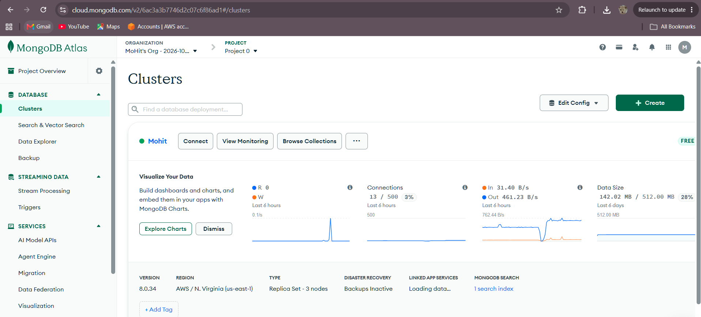 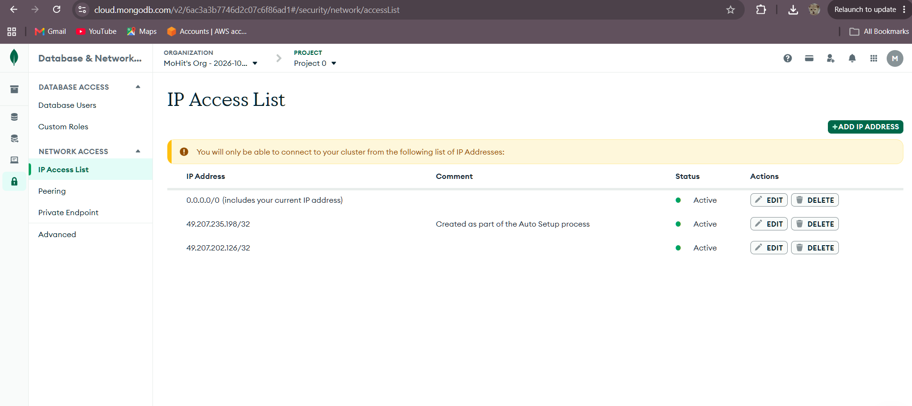 |
| **2. Backend Service** | `systemd` service active & `curl /hello` verification | 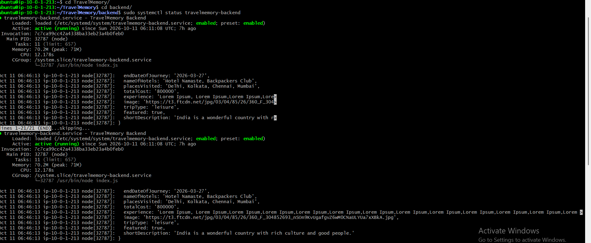 |
| **3. Instances** | 4 Running EC2 Instances across 2 Availability Zones | 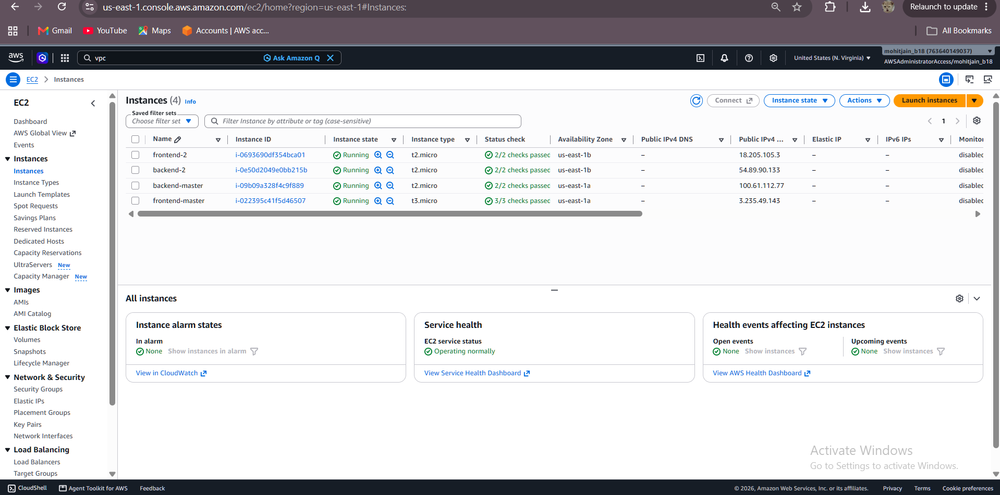 |
| **4. Target Groups** | Both Target Groups showing `Healthy` status | 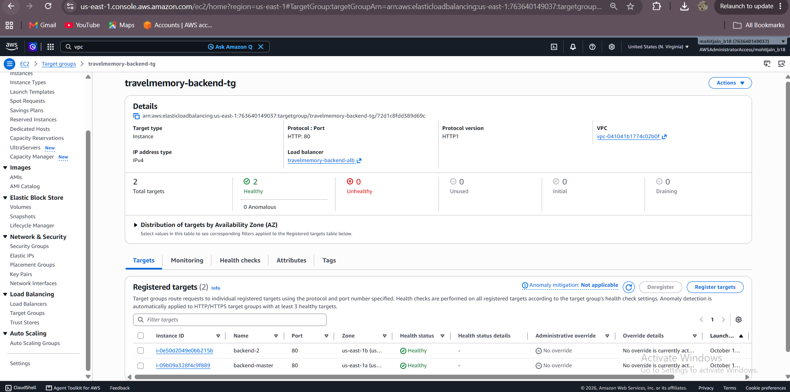 |
| **5. Load Balancers** | Dual ALBs deployed in AWS Default VPC | 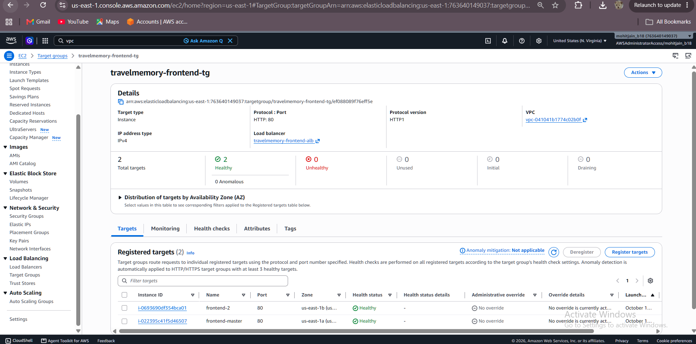 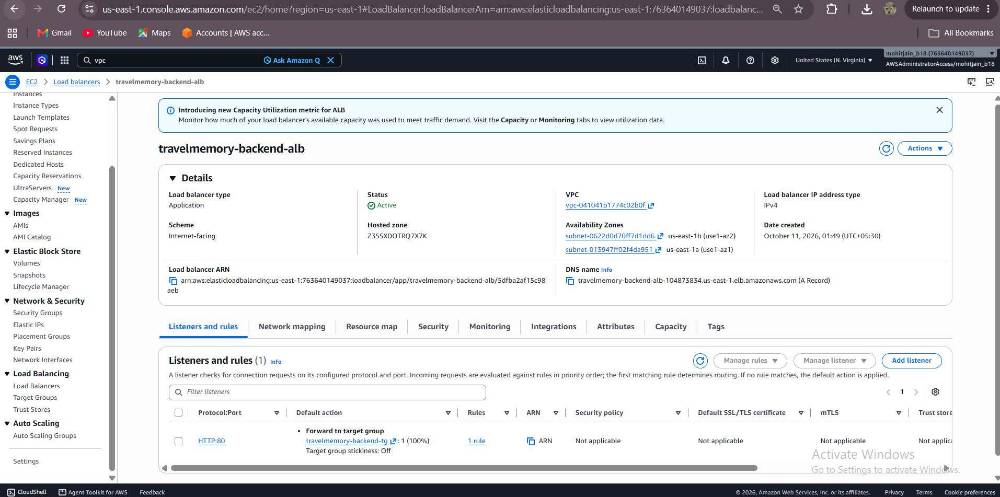 |
| **6. DNS & SSL** | Cloudflare CNAME Records for Root & API subdomain | 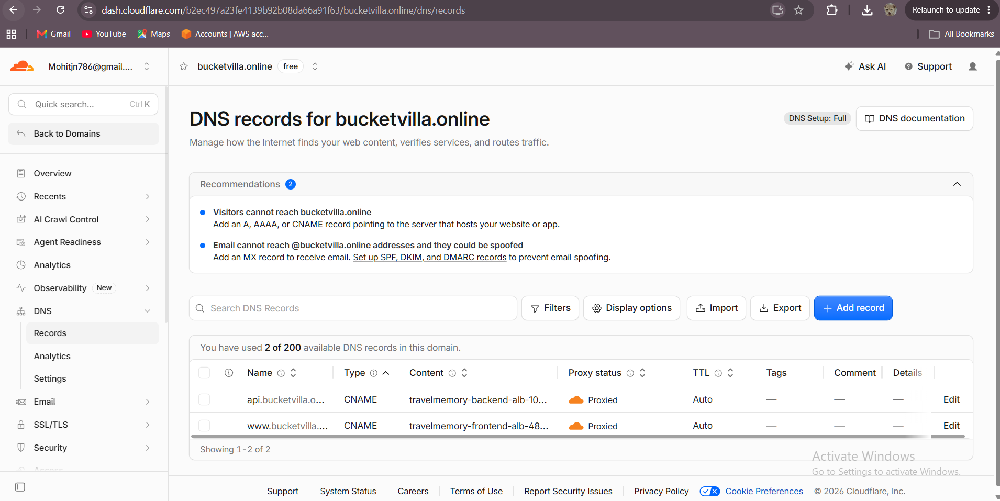 |
| **7. Live App** | Fully functional UI at `https://www.bucketvilla.online` | 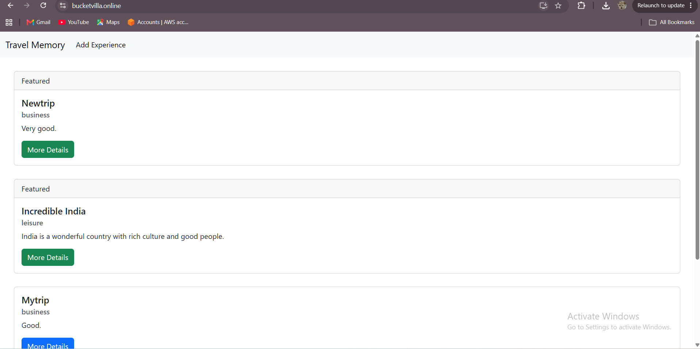 |
| **8. Database CRUD** | Saved experience persisted in MongoDB Atlas | 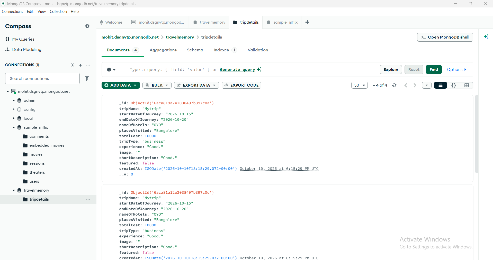 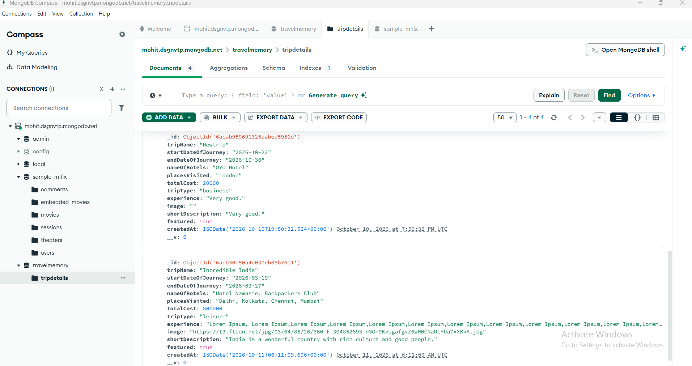 |


---

## 📋 Evaluation Rubric Compliance Checklist

- [x] **Backend Configuration:** Node.js backend running via systemd + Nginx reverse proxy.
- [x] **Frontend Configuration:** React static build served via Nginx with SPA routing.
- [x] **Decoupled Connectivity:** Frontend communicating with backend load balancer over HTTPS.
- [x] **Scaling & Resilience:** Dual instances per tier deployed across multiple Availability Zones via AMIs.
- [x] **Load Balancing:** Distinct Target Groups and ALBs with automated health checks.
- [x] **Domain & SSL:** Custom domain connected via Cloudflare with Flexible SSL.
- [x] **Draw.io Architecture Diagram:** Included in repository (`travelmemory_architecture.drawio`).
- [x] **Documentation & Reproducibility:** Detailed commands, configuration snippets, and explanations provided.

---

## 👤 Author
- **Mohit Jain**
- GitHub: [@Mohit456pro](https://github.com/Mohit456pro)
